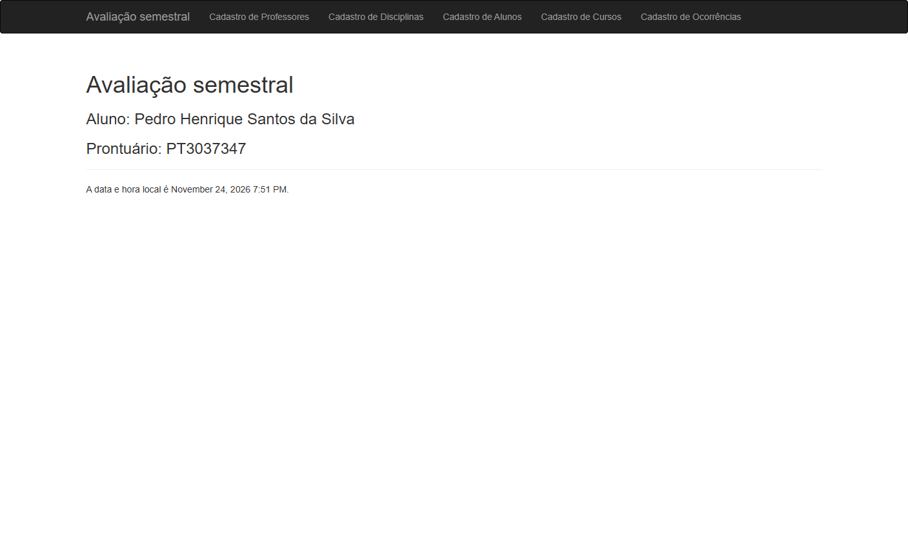

# Avaliação semestral — Cadastro de Alunos

**Aluno** Pedro Henrique Santos da Silva

**Prontuário** PT3037347

Aplicação web desenvolvida com Flask para cadastrar alunos, associá-los a uma disciplina e consultar os registros salvos em banco de dados SQLite.

## Recursos utilizados

- Rotas `/` e `/alunos`.
- Formulário com Flask-WTF.
- Persistência e consulta com Flask-SQLAlchemy.
- Templates Jinja com herança e Flask-Bootstrap.
- Data e hora local com Flask-Moment.
- Tratamento de erros e página “Não disponível” para os demais módulos.

## Tela inicial

